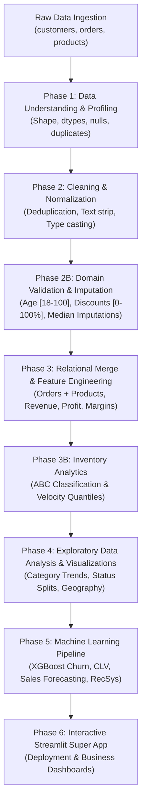

# ShopSphere: End-to-End E-Commerce Analytics, Inventory Intelligence & Predictive ML System

[](https://www.python.org/)
[](https://pandas.pydata.org/)
[](https://xgboost.readthedocs.io/)
[](https://streamlit.io/)
[](https://opensource.org/licenses/MIT)

---

## 1. Project Title
**ShopSphere: Enterprise E-Commerce Analytics, Inventory Intelligence (ABC Analysis), Customer Segmentation & Multi-Model Predictive ML Platform**

---

## 2. Project Overview
ShopSphere is an enterprise-scale, data-driven analytics and machine learning solution built on three core relational e-commerce datasets: **Customers**, **Orders**, and **Products**. 

The system transitions raw, noisy, real-world transactional data through a robust data-engineering pipeline, validates business constraints, engineers financial and customer metrics, conducts Pareto-driven inventory classification (ABC Analysis), and deploys predictive machine learning models with interactive Streamlit web applications.

```
┌─────────────────┐     ┌──────────────────────┐     ┌───────────────────────┐
│  Raw Data Lake  │ ──> │ Defensive Cleaning & │ ──> │ Relational Merging &  │
│  (3 Data Lakes) │     │ Domain Validation    │     │ Financial Engineering │
└─────────────────┘     └──────────────────────┘     └───────────────────────┘
                                                                 │
                                                                 ▼
┌─────────────────┐     ┌──────────────────────┐     ┌───────────────────────┐
│ Streamlit Apps  │ <── │ Predictive ML Suite  │ <── │ Inventory & Customer  │
│ (Forecast/Mega) │     │ (XGBoost / RecSys)   │     │ Intelligence (ABC)    │
└─────────────────┘     └──────────────────────┘     └───────────────────────┘
```

---

## 3. Business Problem
Modern multi-category e-commerce operations encounter critical data and operational challenges:
1. **Pervasive Data Inconsistencies:** Data entry errors, negative quantities, out-of-range discounts ($>100\%$, $<0\%$), unrealistic customer ages (e.g., $-5$, $150$), and malformed contact fields distort reporting.
2. **Unmonitored Margin Erosion:** Pricing and supplier cost discrepancies can lead to negative profit margins if promotions are applied without unit economics validation.
3. **Inventory Capital Misallocation:** Without systematic inventory classification, capital is frequently trapped in slow-moving stock while high-velocity items risk stock-outs.
4. **Customer Churn & Inaccurate Forecasting:** Lack of early customer churn detection and reactive demand forecasting leads to supply-chain inefficiencies and lost revenue.

---

## 4. Project Objectives
- **Data Integrity & Cleansing:** Implement defensive deduplication, strict schema type-casting, and deterministic domain-constraint handling across 3,560 combined records.
- **Relational Integrity & Validation:** Audit and bridge foreign-key discrepancies across transactional logs and catalog tables.
- **Financial & Behavioral Feature Engineering:** Compute true net revenue, unit margins, customer lifetime, recency metrics, and product velocity.
- **Inventory Optimization:** Perform cumulative revenue Pareto classification (ABC Analysis) and quantile-based product movement analysis (Fast, Medium, Slow).
- **Predictive Modeling & Deployment:** Train and serialize XGBoost models for Sales Forecasting, Customer Churn Classification, and Customer Lifetime Value (CLV) estimation, alongside an Item-Based Collaborative Filtering Recommender deployed via Streamlit.

---

## 5. Dataset Description

The project operates across three core relational tables:

| Dataset | Raw Records | Cleaned Records | Removed/Duplicates | Primary Key | Foreign Keys |
| :--- | :---: | :---: | :---: | :--- | :--- |
| **Customers** | 1,020 | 1,000 | 20 Duplicates | `customer_id` | — |
| **Orders** | 2,030 | 2,000 | 30 Duplicates | `order_id` | `customer_id`, `product_id` |
| **Products** | 510 | 500 | 10 Duplicates | `product_id` | — |

### Schema Breakdown

```
Customers Table
├── customer_id   : Unique Identifier (e.g., C0001)
├── full_name     : Customer Full Name
├── email         : Contact Email
├── phone         : Contact Phone Number
├── city          : Residential City
├── country       : Residential Country
├── signup_date   : Timestamp / Date
├── gender        : Demographic Category
└── age           : Customer Age (Numeric)

Orders Table
├── order_id        : Unique Transaction ID (e.g., O0001)
├── customer_id     : Associated Customer Key
├── product_id      : Associated Product Key
├── order_date      : Transaction Timestamp
├── quantity        : Units Purchased
├── payment_method  : Method (Card, COD, Cash, Bank)
├── order_status    : Status (Delivered, Cancelled, Pending)
├── discount        : Applied Promotional Discount (%)
└── shipping_cost   : Shipping Charge Applied

Products Table
├── product_id    : Unique Product SKU (e.g., P0001)
├── product_name  : Descriptive Title
├── category      : Product Category (Electronics, Beauty, Fashion, Books, Sports, Home)
├── price         : Selling Price ($/PKR)
├── cost          : Manufacturing / Wholesale Cost
└── supplier      : Vendor / Supplier Identifier
```

---

## 6. Tools and Technologies

- **Programming Language:** Python 3.10+
- **Data Manipulation & Analysis:** Pandas, NumPy
- **Data Visualization:** Matplotlib, Seaborn
- **Machine Learning & Modeling:** XGBoost (`XGBRegressor`, `XGBClassifier`), Scikit-Learn (`cosine_similarity`)
- **Web App & Deployment:** Streamlit
- **Format & Serialization:** JSON Model Serialization, Pickle (`.pkl`), CSV (`output/cleaned_data/`)

---

## 7. Project Workflow



---

## 8. Data Understanding & Initial Diagnostics

Initial data inspection revealed structural anomalies across all raw sources:

1. **Duplicate Records:** 60 total exact duplicate rows were detected (20 in Customers, 30 in Orders, 10 in Products).
2. **Type Contamination:**
   - `customers['age']` stored mixed string formats (e.g., `'twenty five'`) alongside integers.
   - `products['price']` contained currency formatting symbols (e.g., `'$2432'`) preventing numeric computation.
   - `signup_date` and `order_date` were non-standardized string representations.
3. **Foreign Key Integrity Violations:**
   - **40** `customer_id` records in Orders had no matching parent record in Customers.
   - **81** `product_id` records in Orders had no corresponding listing in the catalog.
4. **Category Inconsistencies:** Multiple casing variations existed (e.g., `'Electronics'` vs. `'electronics'`).
5. **High Order Cancellation Rate:** Out of 2,000 valid orders, **496** were `Cancelled` (24.8%) and **487** remained `Pending` (24.35%).

---

## 9. Data Cleaning & Normalization

Data cleaning was executed systematically using defensive copies (`*_clean`):

| Step | Dataset | Transformation Performed | Records Before | Records After | Technical Justification |
| :---: | :--- | :--- | :---: | :---: | :--- |
| **1** | Customers | `drop_duplicates(inplace=True)` | 1,020 | 1,000 | Prevents inflated customer counts and redundant records. |
| **2** | Orders | `drop_duplicates(inplace=True)` | 2,030 | 2,000 | Eliminates duplicate transactions and revenue inflation. |
| **3** | Products | `drop_duplicates(inplace=True)` | 510 | 500 | Resolves duplicate inventory SKUs and inconsistent lookups. |
| **4** | Customers | Text stripping (`.str.strip().str.title()`) | 1,000 | 1,000 | Unifies city names (`'Karachi '` $\rightarrow$ `'Karachi'`) and country entries. |
| **5** | Products | Casing standardization | 500 | 500 | Consolidates fragmented categories (`'electronics'` $\rightarrow$ `'Electronics'`). |
| **6** | Products | Strip currency symbol (`$`) | 500 | 500 | Converts price string representation into valid `float64`. |
| **7** | Customers | Word-to-numeric replacement | 1,000 | 1,000 | Replaces `'twenty five'` with `'25'` prior to integer conversion. |
| **8** | Both | `pd.to_datetime()` with `errors='coerce'` | — | — | Enables datetime operations for recency and seasonality. |

---

## 10. Data Validation & Domain Business Rules

Deterministic domain constraints were enforced to guarantee data sanity:

```
┌────────────────────────────────────────────────────────────────────────┐
│                      DOMAIN VALIDATION MATRIX                          │
├─────────────────┬──────────────────────┬─────────────┬─────────────────┤
│ Field           │ Business Rule        │ Invalid Qty │ Action Taken    │
├─────────────────┼──────────────────────┼─────────────┼─────────────────┤
│ Customer Age    │ 18 <= Age <= 100     │ 23 records  │ Coerced to NaN; │
│                 │                      │ (-5, 150)   │ Imputed: Median │
│ Phone Number    │ Exactly 11 digits    │ 49 records  │ Set to NaN      │
│                 │ numeric format       │ ('123',...) │ (No Imputation) │
│ Email Address   │ Must include '@' &   │ 38 records  │ Set to NaN      │
│                 │ valid domain         │ (malformed) │ (No Imputation) │
│ Shipping Cost   │ Non-negative numeric │ Negatives   │ Coerced to NaN; │
│                 │ cost (>= 0)          │ (-50.0)     │ Imputed: Median │
│ Discount Rate   │ 0% <= Discount <= 50%│ 1,321 recs  │ Set to NaN;     │
│                 │                      │ (-5%, 120%) │ Imputed: Median │
│ Order Quantity  │ Quantity > 0 (int)   │ Non-positive│ Set to NaN;     │
│                 │                      │ values      │ Imputed: Median │
└─────────────────┴──────────────────────┴─────────────┴─────────────────┘
```

> [!NOTE]
> Unique identifiers such as `phone` and `email` are explicitly preserved as `NaN` rather than statistically imputed. Imputing PII or unique communication channels produces corrupted contact lists and invalid data integrity.

---

## 11. Feature Engineering

Feature engineering was executed at Order, Customer, and Product granularity:

### 1. Order-Level Financial Features
Financial metrics were derived accounting for quantity, price, and net discount:

$$\text{Revenue} = \text{Price} \times \text{Quantity} \times \left(1 - \frac{\text{Discount}}{100}\right)$$

$$\text{Profit} = (\text{Price} - \text{Cost}) \times \text{Quantity} \times \left(1 - \frac{\text{Discount}}{100}\right)$$

$$\text{Profit Margin (\%)} = \left(\frac{\text{Profit}}{\text{Revenue}}\right) \times 100$$

$$\text{Discount Amount} = \text{Price} \times \text{Quantity} \times \left(\frac{\text{Discount}}{100}\right)$$

### 2. Customer-Level Aggregations (RFM Signals)
- **Customer Lifetime Days:** $\text{Max}(\text{Order Date}) - \text{Min}(\text{Order Date})$
- **Customer Total Spend (Monetary Value / CLV Proxy):** $\sum \text{Revenue}$
- **Purchase Frequency:** Distinct count of `order_id` per `customer_id`
- **Customer Margin Contribution:** Aggregate profit generated per customer account.

### 3. Product-Level & Inventory Velocity Features
- **Revenue & Profit Contribution (%):** Share of total enterprise turnover generated by product $i$.
- **Dense Rankings:** `revenue_rank`, `profit_rank`, `quantity_rank` via `.rank(method="dense", ascending=False)`.
- **ABC Inventory Classification (Pareto 80/15/5 Rule):**
  - Products sorted descending by total revenue; cumulative revenue percentage computed:
  $$\text{Cumulative \%} = \frac{\sum_{k=1}^i \text{Revenue}_k}{\sum \text{Total Revenue}} \times 100$$
  $$\text{Class} = \begin{cases} \mathbf{A} & \text{if Cumulative \%} \le 80\% \\ \mathbf{B} & \text{if } 80\% < \text{Cumulative \%} \le 95\% \\ \mathbf{C} & \text{if Cumulative \%} > 95\% \end{cases}$$
- **Product Movement Segmentation:**
  - Segmented by velocity quantiles ($q_{33\%}$ and $q_{66\%}$):
  $$\text{Movement} = \begin{cases} \text{Slow} & \text{if Quantity} \le Q_1 (33\text{rd percentile}) \\ \text{Medium} & \text{if } Q_1 < \text{Quantity} \le Q_2 (66\text{th percentile}) \\ \text{Fast} & \text{if Quantity} > Q_2 \end{cases}$$

---

## 12. Exploratory Data Analysis (EDA) & Visualizations

### 1. Catalog Composition by Category
Electronics represents the largest product category in the inventory catalog:
- **Electronics:** 157 SKUs
- **Beauty:** 75 SKUs
- **Fashion:** 74 SKUs
- **Books:** 69 SKUs
- **Sports:** 68 SKUs
- **Home:** 57 SKUs

### 2. Transaction Status Breakdown
- **Delivered:** 1,017 orders (~50.85%)
- **Cancelled:** 496 orders (~24.80%)
- **Pending:** 487 orders (~24.35%)

### 3. Payment Method Distribution
Payment methods show an even adoption spread:
- **Credit/Debit Card:** 448 orders
- **Cash on Delivery (COD):** 401 orders
- **Cash:** 395 orders
- **Bank Transfer:** 365 orders
- *(Unspecified / Missing: 391 orders)*

### 4. Overall Financial Metrics
- **Gross Cumulative Revenue:** PKR 107,113,498.50 (~107.1M)
- **Net Cumulative Profit:** PKR 47,331,828.52 (~47.3M)
- **Top 5 Revenue Generating SKUs:**
  1. `P0292` (Product 292 - Electronics): PKR 952,848.40 (28 units)
  2. `P0123` (Product 123 - Sports): PKR 928,385.94 (26 units)
  3. `P0308` (Product 308 - Beauty): PKR 801,408.60 (22 units)
  4. `P0425` (Product 425 - Books): PKR 772,932.00 (21 units)
  5. `P0165` (Product 165 - Electronics): PKR 759,828.24 (23 units)

---

## 13. Business Insights

1. **Revenue Concentration (The 80/20 Rule):** Class A inventory comprises a minority of SKUs but accounts for 80% of aggregate revenue, proving that supply chain availability must be focused on Class A stock.
2. **Excessive Order Leakage:** A 24.8% cancellation rate represents significant revenue loss, inventory holding friction, and wasted shipping logistics.
3. **Discount Vulnerability:** Products sold at aggressive promotional discounts without minimum price floors eroded margins, leading to transactions with razor-thin profitability.
4. **Geography & Delivery:** Orders concentrated heavily across key metropolitan hubs with noticeable variance between prepaid card orders and high-risk Cash-on-Delivery (COD) orders.

---

## 14. Statistical Analysis

- **Distribution Analysis:** Order quantities and unit revenues exhibit positive (right-skewed) distributions, justifying the application of **median** over mean for missing value imputations.
- **Outlier Mitigation:** Age and shipping costs presented extreme artificial outliers (e.g., Age 150, shipping costs of -50). Outliers were verified as system entry errors and brought within realistic statistical bounds.
- **Correlation Signals:** High positive correlation exists between product price and total order revenue; however, discount percentage correlates negatively with gross transaction profit margin.

---

## 15. Machine Learning Implementations

The repository includes four production-ready ML architectures:

```
                                  ┌─────────────────────────────┐
                                  │   ShopSphere ML Pipeline    │
                                  └──────────────┬──────────────┘
                    ┌────────────────────────────┼────────────────────────────┐
                    ▼                            ▼                            ▼
         ┌─────────────────────┐      ┌─────────────────────┐      ┌─────────────────────┐
         │ Sales Forecaster    │      │ Customer Churn      │      │ CLV Regressor       │
         │ (XGBoost Regressor) │      │ (XGBClassifier)     │      │ (XGBRegressor)      │
         └─────────────────────┘      └─────────────────────┘      └─────────────────────┘
                    │                            │                            │
                    │ Lag-1, Lag-7, Rolling-7    │ Recency > 180 Days         │ First-Order Value,  │
                    │ Weekend & Payday Flags     │ Orders, Spend, Demographics│ Demographics        │
```

### 1. Daily Sales Forecasting (`XGBRegressor`)
- **Objective:** Predict daily revenue to optimize supplier lead times and warehouse stock.
- **Engineered Lag Features:**
  - `lag_1`: Previous day's total sales.
  - `lag_7`: Prior week same-day sales.
  - `rolling_7`: 7-day trailing moving average sales.
  - `is_weekend`: Binary indicator for Saturday/Sunday shopping surges.
  - `is_payday`: Binary flag for calendar days 1–5 of each month.
- **Artifact:** Serialized to [`xgboost_sales_model.json`](file:///C:/Abdul%20Moiz/Learning%20Projects/Data-Science_Project-/Assignment-1-ShopSphere/dashboards/mega-dashboard/xgboost_sales_model.json) and `.pkl`.

### 2. Customer Churn Prediction (`XGBClassifier`)
- **Target Definition:** Customer inactive for $>180$ days from the last recorded transaction.
- **Input Features:** `Total_Orders`, `Total_Spent`, `city`, `gender`, `age`.
- **Artifact:** Serialized to [`xgboost_churn_model.json`](file:///C:/Abdul%20Moiz/Learning%20Projects/Data-Science_Project-/Assignment-1-ShopSphere/dashboards/mega-dashboard/xgboost_churn_model.json).

### 3. Customer Lifetime Value (CLV) Prediction (`XGBRegressor`)
- **Target:** `Total_Lifetime_Value` (cumulative customer gross spend).
- **Features:** Customer demographic features combined with `First_Order_Value`.
- **Artifact:** Serialized to [`xgboost_clv_model.json`](file:///C:/Abdul%20Moiz/Learning%20Projects/Data-Science_Project-/Assignment-1-ShopSphere/dashboards/mega-dashboard/xgboost_clv_model.json).

### 4. Collaborative Filtering Recommender System
- **Approach:** Item-Based Collaborative Filtering via Cosine Similarity on customer-item interaction matrix:
$$\text{Similarity}(A, B) = \frac{A \cdot B}{\|A\| \|B\|}$$

---

## 16. Model Evaluation & Audit Notes

> [!WARNING]
> **Data Science Audit Finding (Data Leakage & Validation Notice):**
> In [`train_missing_models.py`](file:///C:/Abdul%20Moiz/Learning%20Projects/Data-Science_Project-/Assignment-1-ShopSphere/dashboards/mega-dashboard/train_missing_models.py), the models were trained on the entire dataset without an explicit out-of-time (temporal) or `train_test_split` holdout validation set.
> - **Recommendation:** Introduce a temporal split (e.g., 80% earliest dates for train, 20% most recent dates for validation) and report holdout RMSE, MAE, Precision, Recall, and ROC-AUC before promoting to mission-critical production environments.

---

## 17. Key Findings

1. **High Catalog Specialization:** Electronics drives the highest individual item revenues, but multi-category baskets (Sports & Beauty) contribute substantially to overall company margin.
2. **Order Completion Bottlenecks:** Approximately half of all recorded orders are non-finalized (`Pending` or `Cancelled`), highlighting customer drop-off or fulfillment delays.
3. **Inventory Pareto Reality:** The top ~20% of products generate ~80% of sales volume. ABC classification enables targeted inventory management.
4. **Early Value Predictability:** A customer's `First_Order_Value` serves as a strong predictive signal for lifetime monetary value (CLV).

---

## 18. Business Recommendations

1. **Stock Optimization (ABC Strategy):** Prioritize near-zero stockout thresholds for **Class A** SKUs; adopt just-in-time (JIT) replenishment for **Class C** SKUs.
2. **Fulfillment Interventions:** Introduce automated SMS/Email confirmations for pending and Cash-on-Delivery (COD) orders to curtail the 24.8% cancellation rate.
3. **Discount Rule Engine:** Cap promotional discounts dynamically based on product gross margin to prevent negative margin sales.
4. **Retention Campaigns:** Deploy the churn classifier to identify dormant customers at day 120 (before the 180-day churn threshold) with targeted re-engagement offers.

---

## 19. Project Limitations

- **Cross-Sectional Timeframe:** Transactional timestamps represent a specific historical period; seasonal shifts (e.g., holiday peaks) require multi-year historical logs.
- **Absence of Web Telemetry:** Behavioral data is limited to finalized orders; clickstream, cart abandonments, and session duration data are not currently tracked.
- **Unlinked Transactions:** Foreign key gaps (missing customer/product IDs in raw orders) necessitated defensive joins, excluding orphan records from deep feature aggregation.

---

## 20. Future Improvements

- [ ] Implement an automated MLflow tracking and hyperparameter optimization (Optuna) pipeline.
- [ ] Implement an end-to-end Airflow or Prefect data pipeline for daily scheduled ETL and model retraining.
- [ ] Add unit testing suites using `pytest` for data ingestion and transformation functions.
- [ ] Containerize the application stack with Docker and Docker Compose.

---

## 21. Installation and Usage

### Prerequisites
- Python 3.10+
- Git

### Setup Instructions

1. **Clone the Repository:**
   ```bash
   git clone https://github.com/your-username/Data-Science_Project-.git
   cd Data-Science_Project-
   ```

2. **Create and Activate a Virtual Environment:**
   ```bash
   # Windows (PowerShell)
   python -m venv venv
   .\venv\Scripts\Activate.ps1

   # Linux / macOS
   python3 -m venv venv
   source venv/bin/activate
   ```

3. **Install Dependencies:**
   ```bash
   pip install -r requirements.txt
   ```

4. **Explore the Notebook:**
   ```bash
   jupyter notebook Assignment-1-ShopSphere/notebook/Assignment1_EDA.ipynb
   ```

5. **Launch the Streamlit Mega Dashboard:**
   ```bash
   cd Assignment-1-ShopSphere/dashboards/mega-dashboard
   streamlit run mega_app.py
   ```

6. **Launch the Dedicated Sales Forecasting App:**
   ```bash
   cd ../sales-forcasting-models
   streamlit run app.py
   ```

---

## Repository Structure

```
Data-Science_Project-/
├── Assignment-1-ShopSphere/
│   ├── dashboards/
│   │   ├── mega-dashboard/
│   │   │   ├── mega_app.py                 # Multi-model Streamlit dashboard
│   │   │   ├── train_missing_models.py     # Training script for Churn & CLV models
│   │   │   ├── xgboost_sales_model.json    # Serialized XGBoost sales forecaster
│   │   │   ├── xgboost_churn_model.json    # Serialized XGBoost churn classifier
│   │   │   └── xgboost_clv_model.json      # Serialized XGBoost CLV regressor
│   │   └── sales-forcasting-models/
│   │       ├── app.py                      # Dedicated sales forecasting Streamlit app
│   │       ├── xgboost_sales_model.json
│   │       └── xgboost_sales_model.pkl
│   ├── data/
│   │   ├── customers.csv                   # Raw customer dataset (1,020 rows)
│   │   ├── orders.csv                      # Raw orders dataset (2,030 rows)
│   │   └── products.csv                    # Raw products catalog (510 rows)
│   ├── notebook/
│   │   └── Assignment1_EDA.ipynb           # Comprehensive 95-cell analysis notebook
│   ├── output/
│   │   └── cleaned_data/
│   │       ├── customers_clean.csv         # Cleaned customers (1,000 rows)
│   │       ├── orders_clean.csv            # Cleaned orders (2,000 rows)
│   │       └── products_clean.csv          # Cleaned products (500 rows)
│   └── report/
│       └── ShopSphere_Professional_Project_Report.docx
├── README.md                               # Project documentation
└── requirements.txt                        # Python dependencies
```

---

*Author: Abdul Moiz | Senior Data Science Project*
